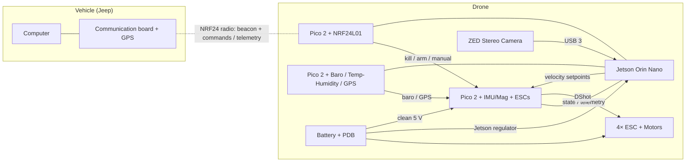
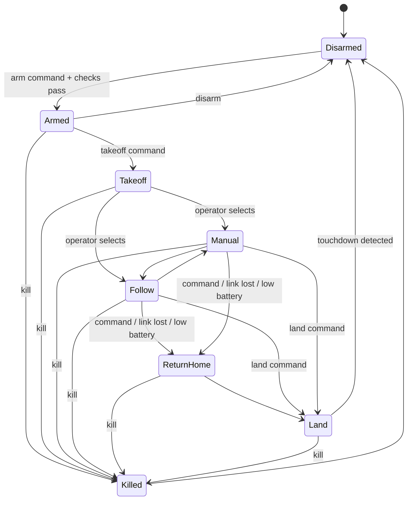

# Following Drone — Design Document

| | |
|---|---|
| **Author** | Michael Lees |
| **Status** | Draft |
| **Last updated** | 2026-10-15 |
| **Revision** | 0.5 |

> Values marked *(proposed)* came from early design discussion and still need confirming. Replace every `TBD` as decisions are made, and keep the revision history at the bottom current.

---

## 1. Overview

### 1.1 Purpose
A drone that has the capability to follow my jeep on off-roading trails. While the drone follows the jeep, it must capture 3D space mappings using the onboard stereographic camera.

### 1.2 Goals
- Setup of ZED stereographic camera and connection to Jetson Orin Nano
- Record raw stereo data to SVO files on the Jetson (record now, map later)
- ZED 3D space mapping, run on recorded SVO files and live
- Data visualization and processing after collection
- Ground-vehicle mapping: camera + Jetson mounted on the jeep to map a real trail before the drone exists
- _Stretch:_ GNSS-referenced maps using the ZED SDK Fusion module

### 1.3 Non-goals
- Flight hardware, flight control, and vehicle following
- Obstacle avoidance

### 1.4 Success criteria

| Criterion | Target | How it's measured |
|---|---|---|
| ZED USB link | Enumerates at USB 3 (5000M) | `lsusb -t` |
| ZED stream stability | HD720 @ 30 fps for 10 min, no dropped frames | ZED Depth Viewer / SDK frame counter |
| SVO recording | TBD min recorded without dropped frames; file replays correctly | ZED SDK recording + playback |
| Mapping accuracy (indoor) | ± TBD cm on 3–5 reference distances | Tape-measured distances vs. distances measured in the mesh |
| Mapping coverage (indoor) | All surfaces of the test room present, no holes > TBD cm | Visual inspection of the mesh |
| Tracking drift | < TBD cm error after a closed loop returning to start | Start vs. end pose from positional tracking |
| Mapping performance | ≥ TBD fps live on the Orin Nano | SDK timing / logs |
| Map export | Mesh / point cloud saved as `.ply` or `.obj` and opens in a viewer | Open in TBD (Open3D / CloudCompare / MeshLab) |
| Ground-vehicle trail map | Continuous map of a TBD m trail section | Visual inspection; drift vs. GPS track |
| Data processing | TBD (filtering, decimation, merging runs, terrain measurement) | TBD |

---

## 2. Requirements

### 2.1 Operating envelope

| Parameter | Value | Notes |
|---|---|---|
| Max target vehicle speed | 20 mph (8.9 m/s) | Jeep on off-road trails |
| Drone max speed | 13–15 m/s *(proposed)* | ~1.5× vehicle speed to catch up after turns and in headwind |
| Follow offset (behind / side / above) | 10 / 5 / 10 m *(proposed)* | Lateral offset so the drone is never directly over the vehicle or trail |
| Max wind | TBD m/s | Drives thrust margin |
| Operating temperature | TBD | Jetson thermal throttling is the likely limit |
| Terrain / environment | Off-road trails: dust, trees, uneven ground, variable lighting | Affects GPS, radio range, and stereo depth quality |
| Launch / landing | Ground, vehicle stopped | No launch or landing on the vehicle |

### 2.2 Functional requirements

#### Milestones

| Milestone | Name | Summary |
|---|---|---|
| **M1** | 3D mapping | ZED + Jetson capture, SVO recording, mapping, post-processing. Software only, no flight. |
| **M2** | Design and simulation | Freeze the hardware and firmware design; prove control, failsafes, and following in simulation before building. |
| **M3** | Flight bring-up | Build the drone; stabilization, altitude and position hold, autonomous takeoff and landing. |
| **M4** | Manual flight | The operator flies the drone from the vehicle, with assisted modes and manual override. |
| **M5** | Vehicle following | The drone follows the jeep using the GPS beacon and maps the trail. |

| ID | Milestone | Requirement |
|---|---|---|
| FR-01 | M1 | The Jetson shall capture stereo video from the ZED over USB 3. |
| FR-02 | M1 | The Jetson shall record raw stereo data to SVO files. |
| FR-03 | M1 | The system shall generate a 3D map (mesh and/or fused point cloud) from live or recorded SVO data. |
| FR-04 | M1 | Maps shall be exportable as `.ply` or `.obj`. |
| FR-05 | M1 | The system shall support post-processing and visualization of maps on a desktop. |
| FR-06 | M1 (stretch) | Maps shall be geo-referenced using GNSS data. |
| FR-07 | M2 | The design (architecture, inter-board bus, mass and power budgets, PCB schematics) shall be reviewed and frozen before the hardware build. |
| FR-08 | M2 | A simulation environment shall model the drone's dynamics and its sensors (IMU, magnetometer, barometer, GPS, ZED). |
| FR-09 | M2 | The FC control and estimation code shall run unmodified in software-in-the-loop (SITL) simulation. |
| FR-10 | M2 (optional) | The FC firmware shall run on a Pico 2 in hardware-in-the-loop (HITL) simulation. |
| FR-11 | M2 | Failsafes (SR-04 – SR-07) shall be demonstrated in simulation. |
| FR-12 | M2 | Follow logic shall be demonstrated in simulation against a simulated vehicle at up to 20 mph. |
| FR-13 | M3 | The flight controller shall stabilize the drone without the Jetson. |
| FR-14 | M3 | The drone shall hold altitude and position using barometer, rangefinder, and GPS. |
| FR-15 | M3 | The drone shall take off from and land on the ground autonomously. |
| FR-16 | M3 | The drone shall send telemetry (battery, state, position) to the vehicle. |
| FR-17 | M4 | The operator shall be able to fly the drone manually from the vehicle with a controller (TBD: handheld transmitter or gamepad on the computer). |
| FR-18 | M4 | Manual flight shall support stabilized, altitude-hold, and position-hold modes. |
| FR-19 | M4 | The operator shall be able to take manual control from any autonomous mode immediately. |
| FR-20 | M4 | The drone shall record SVO data during manual flight. |
| FR-21 | M5 | The drone shall receive the vehicle's GPS position, velocity, and heading from the communication board. |
| FR-22 | M5 | The drone shall hold a commanded offset from the vehicle up to the vehicle's max speed. |
| FR-23 | M5 | The drone shall map the trail while following. |
| FR-24 | M5 | The drone shall return to and land near the stopped vehicle on command. |
| FR-25 | M5 (later) | Vision tracking shall refine the vehicle's relative position. |

### 2.3 Safety requirements

| ID | Requirement |
|---|---|
| SR-01 | Flight stabilization shall run entirely on the flight controller and survive a Jetson failure. |
| SR-02 | Arm, disarm, and kill commands shall reach the flight controller directly from the radio module, not via the Jetson. |
| SR-03 | A kill command shall stop all motors within TBD ms. |
| SR-04 | Loss of Jetson setpoints for > TBD ms shall cause the drone to hold position, then land. |
| SR-05 | Loss of the radio link shall cause the drone to hover, then return home and land. |
| SR-06 | Low battery shall trigger return and landing with ≥ TBD % reserve. |
| SR-07 | The drone shall stay inside a geofence (max altitude, max distance from vehicle). |
| SR-08 | The drone shall not fly directly over the vehicle or the trail. |
| SR-09 | The flight controller shall refuse to arm unless all arming checks pass. |
| SR-10 | A hardware watchdog shall reset a stalled flight controller loop. |

### 2.4 Regulatory
Assumes US (FAA) rules. Confirm for your location.

- Determine whether flights are recreational or Part 107; requirements differ.
- Register the drone (it will exceed 250 g).
- Remote ID: a built-in or broadcast module is required.
- Visual line of sight is required. Plan for a spotter in the jeep.
- Part 107 forbids operating from a moving vehicle except over sparsely populated areas. Check whether trail locations qualify.
- Max altitude 400 ft (120 m) AGL.
- Check land-use rules for each trail (national parks prohibit drones, for example).

---

## 3. System Architecture

### 3.1 Block diagram



**Inter-board links:** the Jetson, radio Pico, sensor Pico, and FC share one CAN bus (see 3.3). The arrows show logical data flow, not separate wires.

**M1 setup:** only the ZED, the Jetson, and a power source (bench supply or the jeep's 12 V via a DC-DC converter).

### 3.2 Modules

| Module | MCU / SoC | Responsibilities | Inputs | Outputs |
|---|---|---|---|---|
| Companion computer | Jetson Orin Nano | SVO recording, 3D mapping, beacon fusion, follow controller, logging | ZED stream, beacon, FC state, sensor data | Velocity setpoints, maps, logs |
| Radio | Pico 2 + NRF24L01 (PA/LNA) | Radio link to the vehicle; route safety commands directly to the FC | Beacon and command packets | Commands → FC; beacon → Jetson; telemetry → vehicle |
| Sensors | Pico 2 + Baro + Temp/Humidity + GPS | Sample sensors and timestamp data | Baro, GPS, temp/humidity | Sensor data → FC and Jetson |
| Flight controller | Pico 2 + IMU/Mag + 4× ESC | Estimation, rate and attitude control, altitude and position hold, failsafes, arming | IMU, mag, sensor data, setpoints, commands | DShot to ESCs, state/telemetry |
| Camera | ZED (model TBD: ZED 2i / ZED Mini) | Stereo images, depth, visual odometry | — | USB 3 stream to the Jetson |
| Vehicle comm board | Pico 2 + NRF24L01 + GPS *(proposed)* | Broadcast vehicle GPS (beacon); relay operator commands | Computer commands, GPS | Beacon and command packets; telemetry → computer |

### 3.3 Interconnects

| Link | From → To | Physical layer | Data rate | Message rate | Notes |
|---|---|---|---|---|---|
| Camera | ZED → Jetson | USB 3 | High (video) | 15–60 fps | Must run at USB 3 speed (5000M) |
| Radio link | Vehicle ↔ Radio Pico | NRF24 2.4 GHz | 250 kbps–2 Mbps | Beacon 5–10 Hz; commands on demand | Telemetry uses ACK payloads |
| Safety commands | Radio Pico → FC | CAN | 1 Mbps (shared) | On demand | Highest-priority CAN IDs; no Jetson involvement |
| Sensor data | Sensor Pico → FC | CAN | 1 Mbps (shared) | Baro 50–100 Hz, GPS 5–10 Hz | |
| Setpoints | Jetson → FC | CAN | 1 Mbps (shared) | 10–50 Hz | |
| FC state | FC → Jetson | CAN | 1 Mbps (shared) | TBD Hz | |
| Radio data | Radio Pico ↔ Jetson | CAN | 1 Mbps (shared) | Beacon rate | |
| Sensor data | Sensor Pico → Jetson | CAN | 1 Mbps (shared) | TBD | Needed for GNSS map fusion |
| Motor output | FC → ESCs | DShot300/600 via PIO *(proposed)* | | 1–2 kHz | |

**Decision: CAN bus** (see section 13). Classic CAN at 1 Mbps, one shared twisted pair, terminated at both ends.

- **Why CAN:** differential signaling resists ESC and motor noise; any node can transmit (the radio reaches the FC with the Jetson down); message priority by ID; hardware CRC and retransmission; faulty nodes take themselves off the bus.
- **Rejected:** I2C (single-ended, short on-board traces only, bus can lock up, single controller, no CRC); USB hub (vibration and EMI); UART (point-to-point only, FC would need three ports).
- **Load estimate:** ~5 KB/s (~40 kbps) of payload, well under 10% of a 1 Mbps bus.
- **Upgrade path:** the transceivers support CAN FD (2 Mbps for TCAN1042HV, 5 Mbps for "G" variants), so moving to CAN FD later means changing only the controllers.
- **I2C / SPI stay on each board:** I2C for barometer, temp/humidity, magnetometer; SPI for the IMU and NRF24.

### 3.4 Failure modes

| Failure | Detection | Response |
|---|---|---|
| Jetson crash / hang | Setpoint timeout on FC | Hold position, then land |
| Radio link lost | No packets for 1 s | Hover; after TBD s, return home and land |
| GPS loss (drone) | Fix lost / low satellite count | Hold altitude, attitude-only; land |
| Beacon GPS loss (vehicle) | Fix quality in beacon packet | Hold position; resume when fix returns, else return home |
| Low battery | Voltage/current sensor on FC | Return and land with reserve |
| Inter-board link lost | Per-link timeout | See 7.3 |
| Target lost (vision) | Tracker confidence | Fall back to beacon only |
| ZED disconnect (M1) | SDK error / no frames | Close the current SVO file, attempt reconnect, log the event |
| Storage full (M1) | Free-space check | Stop recording cleanly; alert operator |

---

## 4. Hardware

### 4.1 Airframe

| Item | Selection | Mass (g) | Notes |
|---|---|---|---|
| Frame | 7" (ZED Mini) or 10" (ZED 2i + gimbal) *(proposed)* | | |
| Motors ×4 | 2806–3110 class, mid KV *(proposed)* | | |
| Props | 7–10" to match frame | | |
| ESCs ×4 | ~40 A, DShot-capable (BLHeli_32 / AM32 / Bluejay) *(proposed)* | | |
| Camera mount / gimbal | 2-axis gimbal (pitch / roll) *(proposed)* | | Fixed ~20° mount acceptable for first flights |

### 4.2 Mass budget

| Component | Mass (g) |
|---|---|
| Frame | |
| Motors | |
| ESCs | |
| Props | |
| Battery | |
| Jetson Orin Nano + carrier + cooling | ~200 (verify) |
| ZED camera | ~166 (ZED 2i) / ~63 (ZED Mini) (verify) |
| Gimbal | |
| Pico modules (×3) | |
| GPS + mast | |
| Wiring / connectors / hardware | |
| **Total all-up weight** | **TBD (target 1.2–1.8 kg)** |

**Thrust-to-weight:** total max thrust TBD g ÷ AUW TBD g = **TBD** (target: 2.5:1 to 3:1)

### 4.3 Power

#### Power architecture
- Battery → main switch / anti-spark connector (XT60 / XT90) → power distribution board
- PDB → 4× ESC
- PDB → dedicated regulator for the Jetson (input range TBD, depends on carrier board)
- PDB → filtered 5 V regulator for the Pico modules
- Voltage/current sensor between battery and PDB, read by the FC

**M1 bench and jeep power:** bench supply indoors; the jeep's 12 V through a DC-DC converter rated for the Jetson's input.

#### Power budget

| Load | Voltage | Typical (W) | Peak (W) |
|---|---|---|---|
| Motors (hover) | Battery | TBD | TBD |
| Jetson Orin Nano | TBD | TBD (power mode TBD) | 15–25 |
| ZED camera | 5 V (USB) | ~2 | TBD |
| Pico modules | 5 V | < 1 each | TBD |
| Radio (NRF24 PA/LNA) | 3.3 V | < 0.5 | TBD |
| **Total** | | | |

#### Battery and endurance

| Parameter | Value |
|---|---|
| Chemistry / cell count | 6S Li-ion or LiPo *(proposed)* |
| Capacity (mAh) | 5000–8000 *(proposed)* |
| Usable energy (Wh) | TBD |
| Estimated hover time | TBD |
| Estimated follow-flight time | 12–20 min (rough estimate) |
| Reserve for landing | TBD % |

### 4.4 PCB modules

#### 4.4.0 Common CAN interface (all drone boards)
Each Pico board on the CAN bus (FC, radio, sensors) carries the same CAN circuit, based on the TI TCAN1042-Q1 datasheet (SLLSES9D) reference circuit for a 3.3 V controller (Figure 10-4) and layout guidelines (section 12).

- **Controller:** `can2040` on the Pico 2's PIO (classic CAN), TXD / RXD on two GPIO pins. Alternative for CAN FD: MCP2518FD over SPI.
- **Transceiver:** TCAN1042HV-Q1 (SOIC-8). VCC = 5 V (4.5–5.5 V), VIO = 3.3 V from the Pico (3.0–5.5 V allowed). Equivalent parts: TCAN1042V, TCAN1042GV, TCAN1042HGV.

```
            5 V ──┬──────────────┐
                 4.7µF   0.1µF   │
                  │       │      │ VCC (3)
                 GND     GND  ┌──┴──────────────┐
Pico GPIO (TX) ───────────────┤1 TXD    CANH 7 ├──┬── R 60Ω ──┬────── TVS ── J1 CANH
Pico GPIO (RX) ───────────────┤4 RXD    CANL 6 ├──┼── R 60Ω ──┤ ┌──── TVS ── J1 CANL
Pico GPIO / GND ─┬────────────┤8 STB           │  │           4.7nF
                10kΩ          │     VIO 5  GND 2│  │           │
                 │            └──────┬──────┬──┘  (split termination
                GND          3.3 V ──┤      │      only on the two
                             0.1µF ──┘     GND      end nodes)
```

| Ref | Part | Purpose | Required? |
|---|---|---|---|
| U1 | TCAN1042HV-Q1 (SOIC-8) | CAN transceiver | Yes |
| C1 | 4.7 µF on VCC | Bulk capacitance | Yes |
| C2 | 0.1 µF on VCC, at pin 3 | Decoupling | Yes |
| C6 | 0.1 µF on VIO, at pin 5 | Decoupling | Yes |
| R5 | 10 kΩ STB → GND | Holds normal mode (STB has an internal pull-up; floating = standby) | Yes, unless STB is driven low by a GPIO |
| R6, R7 | 2 × 60 Ω | Split termination (120 Ω) | Fit on every board; enable with a solder jumper on the two end nodes only |
| C3 | 4.7 nF, termination midpoint → GND | Common-mode filtering | With R6 / R7 |
| D1 | Bidirectional CAN TVS (e.g. NUP2105L, PESD2CAN), at the connector | ESD / transient protection | Recommended |
| L1 | Common-mode choke on CANH / CANL | Extra EMC margin | Optional footprint (bridge if unused) |
| J1 | JST-GH 4-pin: 5 V, CANH, CANL, GND (DroneCAN pinout) | Bus connector | Yes |

**Layout rules:**
- TVS and filter parts at the connector, in the signal path.
- Decoupling capacitors at the VCC and VIO pins, each with two vias to ground.
- Solid power and ground planes.
- Keep the stub from the bus to the transceiver to a few cm (ISO 11898 max 0.3 m).

**Bus wiring:** twisted pair for CANH / CANL. Exactly two terminations, at the physical ends of the bus; a board that may be removed should not be a termination point.

**Jetson connection:** TBD. The Orin Nano module has a CAN controller; check whether the carrier exposes it (it still needs a TCAN1042 transceiver). Fallback: a USB-to-CAN adapter (SocketCAN on Linux).

**Prototype first:** TCAN1042 / SN65HVD230 breakout boards on a breadboard with two Picos before committing to PCBs.

#### 4.4.1 Flight controller — Pico 2 + IMU/Mag + ESC outputs
- **Function:** state estimation, control loops, motor output, failsafes, arming
- **Key components:** RP2350 (Pico 2), CAN interface (4.4.0), SPI IMU (ICM-42688-P or BMI270 *(proposed)*), magnetometer (see 4.5), SPI flash or SD for logging, battery voltage/current input
- **Connectors / pinout:** 4× ESC signal, IMU SPI + data-ready interrupt, CAN bus (see 4.4.0), debug (SWD)
- **Power input:** filtered 5 V
- **Mounting / vibration isolation:** soft-mounted at the frame center
- **Schematic / layout link:** TBD
- **Open issues:** magnetometer location

#### 4.4.2 Radio — Pico 2 + NRF24L01
- **Function:** link to the vehicle; route safety commands directly to the FC
- **Key components:** RP2350, CAN interface (4.4.0), NRF24L01+ PA/LNA module, external antenna
- **Connectors / pinout:** NRF24 SPI, CAN bus (see 4.4.0)
- **Power input:** 5 V → 3.3 V with bulk decoupling (the PA draws current spikes)
- **Mounting / vibration isolation:** antenna away from carbon frame and the ZED's USB cable
- **Schematic / layout link:** TBD
- **Open issues:** range in tree cover

#### 4.4.3 Sensors — Pico 2 + Baro + Temp/Humidity + GPS
- **Function:** sample sensors and timestamp data
- **Key components:** RP2350, CAN interface (4.4.0), barometer (TBD), temp/humidity (TBD), u-blox GPS (M8 / M9 / M10, same model as the vehicle)
- **Connectors / pinout:** I2C to barometer and temp/humidity, GPS UART, CAN bus (see 4.4.0)
- **Power input:** 5 V
- **Mounting / vibration isolation:** GPS on a mast; baro covered with foam
- **Schematic / layout link:** TBD
- **Open issues:** whether the magnetometer moves to this board

#### 4.4.4 Vehicle communication board
- **Function:** broadcast the vehicle's GPS; relay commands from the computer; receive telemetry
- **Key components:** Pico 2 *(proposed)*, NRF24L01+ PA/LNA, u-blox GPS (same model as the drone)
- **Connectors / pinout:** USB to the computer, roof-mounted GPS antenna, radio antenna
- **Power input:** vehicle 12 V via regulator, or USB
- **Mounting / vibration isolation:** inside the cab with external antennas
- **Schematic / layout link:** TBD
- **Open issues:** TBD

### 4.5 Sensor placement
- **IMU:** at the center of mass, soft-mounted to isolate vibration.
- **Magnetometer:** on the GPS mast, away from ESC and battery current. If it stays on the FC board, it needs current-based compensation.
- **GPS antenna:** on top of a mast with a clear view of the sky.
- **Barometer:** covered with foam and shielded from prop wash.
- **ZED:** front-mounted on a gimbal or angled mount, with a clear field of view past the props.

### 4.6 M1 mapping rig
- **Indoor:** ZED + Jetson on a handheld rig or cart, powered by a bench supply or power bank.
- **Jeep:** ZED on a rigid, vibration-damped mount (roof or bull bar) with the Jetson in the cab, powered from 12 V through a DC-DC converter.
- **Storage:** NVMe SSD on the Jetson for SVO files.

---

## 5. Firmware

### 5.1 Flight controller (Pico 2 + IMU/Mag + ESCs)

#### Firmware structure
Hardware drivers (IMU, DShot, buses) sit behind a hardware abstraction layer (HAL). Estimation, control, mixing, failsafes, and the state machine are plain portable code with no direct hardware access, so the same code can be built for the Pico 2 or for a desktop SITL build (M2, see 10.2).

#### Core allocation

| Core | Tasks |
|---|---|
| Core 0 | IMU read, filtering, state estimation, rate and attitude loops, motor output. Nothing else, to keep timing deterministic. |
| Core 1 | Communication (radio, sensors, Jetson), arming logic, failsafes, altitude and position loops, logging |

#### Control loops

| Loop | Rate (Hz) | Inputs | Outputs | Runs on |
|---|---|---|---|---|
| Rate | 1000–2000 | Gyro, rate setpoint | Motor mix | FC core 0 |
| Attitude | 250–500 | Attitude estimate, attitude setpoint | Rate setpoint | FC core 0 |
| Altitude | 50–100 | Baro, rangefinder, accel | Thrust setpoint | FC core 1 |
| Velocity / position | 50–100 | GPS, estimate, velocity setpoint | Attitude setpoint | FC core 1 |
| Follow logic | 10–30 | Vehicle state, drone state | Velocity setpoint | Jetson |

#### State estimation
EKF fusing IMU (1–8 kHz), magnetometer, barometer, rangefinder, and GPS (5–10 Hz). States: attitude, position, velocity, gyro and accel biases. Gyro filtering: low-pass plus a notch at the motor frequency (TBD: RPM-based notch via bidirectional DShot).

#### Motor output
DShot300/600 generated by PIO *(proposed)*. Fallback: OneShot125 or ≥ 400 Hz PWM. Standard 50 Hz servo PWM is too slow. Quad-X mixer.

#### Flight modes and state machine



Failsafe hold (setpoint or link timeout) is a sub-state of Follow; see 7.3.

**Manual sub-modes (M4):** Stabilized (stick → attitude), Altitude hold (stick → attitude, throttle → climb rate), Position hold (stick → velocity). Any stick input above TBD % deflection in Follow or ReturnHome switches to Manual immediately (FR-19).

#### Arming checks
- Level within TBD°
- Throttle at zero
- IMU, barometer, and magnetometer healthy
- GPS fix with ≥ TBD satellites (for modes that need GPS)
- Battery above TBD V
- Radio link active
- No active failsafe

#### Logging
Gyro, accelerometer, setpoints, motor outputs, estimator state, and failsafe events, logged at TBD Hz to SPI flash or SD. Download after flight for PID tuning and crash analysis.

### 5.2 Radio module (Pico 2 + NRF24L01)
- Receives beacon and command packets from the vehicle.
- Forwards arm, disarm, kill, and mode commands **directly** to the FC.
- Forwards beacon data to the Jetson.
- Sends telemetry back to the vehicle in NRF24 ACK payloads.
- Reports link quality (packet loss, last-packet age).

### 5.3 Sensor module (Pico 2 + Baro / Temp-Humidity / GPS)

| Sensor | Rate | Sent to |
|---|---|---|
| Barometer | 50–100 Hz | FC, Jetson |
| GPS (UBX-NAV-PVT) | 5–10 Hz | FC, Jetson |
| Temp / humidity | 1 Hz | Jetson (logging; air-density correction) |

All samples are timestamped. GPS time is used to sync clocks across modules.

### 5.4 Vehicle communication board
- GPS at 5–10 Hz using UBX-NAV-PVT (position, velocity, heading in one message).
- Broadcasts a BEACON packet every GPS update (see 7.2).
- Relays operator commands from the computer and sends telemetry back to it over USB.

---

## 6. Jetson Software

### 6.1 Software stack
- JetPack: TBD version
- ZED SDK: TBD version (must match JetPack)
- Middleware: none (no ROS). Inter-process messaging: TBD (custom; gz-transport for the simulator bridge)
- Languages: TBD (Python / C++)
- Desktop post-processing: TBD (Open3D / CloudCompare / MeshLab)

### 6.2 Processes / nodes

| Process | Milestone | Rate | Inputs | Outputs |
|---|---|---|---|---|
| ZED capture + SVO recorder | M1 | Camera fps | ZED stream | SVO files |
| Spatial mapping (live or from SVO) | M1 | TBD | Stereo frames, positional tracking | Mesh / point cloud |
| Map export + post-processing | M1 | Offline | Map | `.ply` / `.obj` |
| GNSS fusion | M1 (stretch) | GPS rate | Sensor GPS, ZED tracking | Geo-referenced pose / map |
| Simulation bridge | M2 | Sim rate | Gazebo (gz-transport) | Simulated sensors / ZED → software under test |
| FC bridge | M3 | TBD | CAN (SocketCAN) | Drone state; setpoints to FC |
| Beacon receiver | M5 | 5–10 Hz | Radio Pico | Vehicle state |
| Target estimator (Kalman filter) | M5 | 10–30 Hz | Beacon, drone state, vision (later) | Vehicle position / velocity |
| Follow controller | M5 | 10–30 Hz | Vehicle estimate, drone state | Velocity setpoints → FC |
| Logger | All | — | All | Logs |

### 6.3 Mapping pipeline (M1)
1. **Capture:** record SVO at TBD resolution / fps with TBD compression.
2. **Tracking:** ZED positional tracking (visual-inertial; GNSS fusion as a stretch goal).
3. **Mapping:** spatial mapping as a mesh or fused point cloud.
4. **Export:** save as `.ply` / `.obj`.
5. **Post-process:** TBD (filtering, decimation, merging runs, terrain measurement).

Settings to evaluate: depth mode, mapping resolution, mapping range, mesh vs. point cloud, live vs. offline from SVO.

### 6.4 Target tracking (M5)
- **Primary:** vehicle GPS beacon. Fix quality is checked on every packet.
- **Filter:** Kalman filter with a constant-velocity or constant-turn-rate vehicle model, with link latency corrected using GPS timestamps.
- **Later:** vehicle detection (YOLO via TensorRT) plus tracking (ByteTrack / BoT-SORT) and ZED depth to refine the relative position.

### 6.5 Follow controller (M5)
- Velocity setpoint = vehicle velocity (feed-forward) + correction toward the desired offset position.
- The offset is defined in the vehicle's frame (behind / side / above) and is never directly over the vehicle.
- The drone yaws to keep the camera pointed at the trail or vehicle (TBD).

### 6.6 Obstacle awareness
Out of scope for v1. Later: ZED forward depth for obstacle detection.

---

## 7. Communication Protocols

### 7.1 Framing
- **CAN bus:** classic CAN frames, 11-bit IDs, up to 8 data bytes. CRC, acknowledgement, and retransmission are handled by CAN hardware. Messages longer than 8 bytes are split across frames with a small transfer header (sequence / frame index); scheme TBD, DroneCAN multi-frame transfers are a reference.
- **USB links (vehicle computer ↔ comm board):** COBS framing + CRC-16 *(proposed)*.
- **Radio:** one message per NRF24 packet (≤ 32 bytes), using NRF24 hardware CRC + optional CRC-16.
- **Every message:** message ID, sequence number, timestamp.

### 7.2 Message definitions

#### CAN ID allocation *(proposed)*
Lower ID = higher priority (wins arbitration).

| ID range | Priority | Messages |
|---|---|---|
| 0x000–0x00F | Critical | KILL, DISARM, ARM, failsafe triggers (radio Pico → FC) |
| 0x010–0x03F | High | Other COMMANDs, SETPOINT (Jetson → FC) |
| 0x040–0x07F | Medium | SENSOR_DATA (baro, GPS), FC_STATE |
| 0x080–0x0FF | Normal | BEACON relay, TELEMETRY |
| 0x100+ | Low | Logging, diagnostics, heartbeats |


#### BEACON (ID 0x01)
- **Direction:** Vehicle comm board → Drone (radio Pico → Jetson, and FC for return home)
- **Rate:** 5–10 Hz (every GPS update)
- **Link:** NRF24

| Offset | Field | Type | Units | Description |
|---|---|---|---|---|
| 0 | msg_id | uint8 | — | 0x01 |
| 1 | seq | uint8 | — | Sequence number |
| 2 | gps_time | uint32 | ms | GPS time of week |
| 6 | lat | int32 | deg × 1e7 | Latitude |
| 10 | lon | int32 | deg × 1e7 | Longitude |
| 14 | alt | int32 | mm | Altitude (MSL) |
| 18 | vel_n | int16 | cm/s | North velocity |
| 20 | vel_e | int16 | cm/s | East velocity |
| 22 | vel_d | int16 | cm/s | Down velocity |
| 24 | heading | int16 | deg × 100 | Heading of motion |
| 26 | fix_type | uint8 | — | GPS fix type |
| 27 | num_sats | uint8 | — | Satellites used |
| 28 | crc16 | uint16 | — | Optional CRC |

Total: 30 bytes.

#### COMMAND (ID 0x02)
- **Direction:** Vehicle → Drone (radio Pico → FC directly)
- **Rate:** on demand, repeated until acknowledged
- **Link:** NRF24

| Offset | Field | Type | Units | Description |
|---|---|---|---|---|
| 0 | msg_id | uint8 | — | 0x02 |
| 1 | seq | uint8 | — | Sequence number |
| 2 | command | uint8 | — | ARM / DISARM / KILL / TAKEOFF / LAND / RETURN_HOME / SET_MODE |
| 3 | param | TBD | TBD | Command parameter (e.g., mode, offset) |
| TBD | crc16 | uint16 | — | Optional CRC |

#### TELEMETRY (ID 0x03)
- **Direction:** Drone → Vehicle (NRF24 ACK payload)
- **Rate:** with each received packet
- **Link:** NRF24
- **Fields:** TBD (flight state, battery voltage, position, failsafe flags, link quality)

#### SETPOINT (ID 0x10)
- **Direction:** Jetson → FC
- **Rate:** 10–50 Hz
- **Link:** CAN
- **Fields:** TBD (velocity N/E/D, yaw rate or yaw, frame flags)

#### FC_STATE (ID 0x11)
- **Direction:** FC → Jetson
- **Rate:** TBD
- **Link:** CAN
- **Fields:** TBD (attitude, position, velocity, mode, battery, failsafe flags)

#### SENSOR_DATA (ID 0x20)
- **Direction:** Sensor Pico → FC, Jetson
- **Rate:** per sensor (see 5.3)
- **Link:** CAN
- **Fields:** TBD (baro pressure / altitude, GPS PVT, temp / humidity)

### 7.3 Timeouts

| Link | Timeout | Action on timeout |
|---|---|---|
| Radio (any packet) | 1 s | Hover |
| Radio (any packet) | TBD s | Return home and land |
| Beacon (valid fix) | TBD s | Hold position; return home if not restored |
| Jetson setpoints → FC | 200–500 ms | Hold position, then land |
| Sensor Pico → FC | TBD ms | Attitude + altitude-from-accel only; land |
| Radio Pico → FC | TBD ms | Treat as radio link lost |

---

## 8. Ground Station (Vehicle)

### 8.1 Hardware
- Computer in the jeep (TBD: laptop / mini PC)
- Communication board connected over USB
- GPS antenna on the roof; radio antenna outside the cab
- Power from the jeep's 12 V

### 8.2 Operator interface
- Arm / disarm, takeoff, land, return home, and **kill**
- Mode selection and follow-offset adjustment
- Manual flight input (M4): TBD — handheld transmitter or gamepad on the computer. Sticks for roll, pitch, yaw, throttle; switches for mode and arm; kill on a dedicated switch.
- Telemetry: flight state, battery, position, link quality, failsafe status
- Map of vehicle and drone positions
- TBD: live video

### 8.3 Operating procedure

**Preflight**
- Check props, frame, and battery
- Both GPS units have a fix
- Radio link up; telemetry received
- Geofence and offset set
- Kill command tested with motors disarmed
- Spotter briefed

**Launch:** vehicle stopped → arm → takeoff → climb to follow height → switch to Follow → vehicle starts moving.

**Follow:** monitor telemetry and battery; spotter keeps visual line of sight.

**Landing:** vehicle stops → land or return-home command → drone lands at an offset from the vehicle → disarm.

**Post-flight:** download FC logs and SVO files; record notes.

---

## 9. Safety

### 9.1 Hazard analysis

| Hazard | Cause | Severity | Likelihood | Mitigation |
|---|---|---|---|---|
| Drone falls | Jetson crash takes down flight | High | TBD | Stabilization runs on the FC alone (SR-01) |
| Flyaway | Bad GPS / magnetometer heading | High | TBD | Mag on mast, arming checks, geofence, kill |
| Collision with vehicle / people | Follow error, bad offset | High | TBD | Lateral offset, never over the vehicle (SR-08), kill |
| Crash into trees | No obstacle sensing | Medium | TBD | Follow height above tree line; spotter |
| Battery fire | LiPo damage in a crash | High | TBD | LiPo bag, inspect after crashes, fire extinguisher in the jeep |
| Loss of link | Range, terrain, trees | Medium | TBD | Radio failsafes (SR-05) |
| Uncontrolled motor start | Arming error | High | TBD | Arming checks (SR-09), props off for bench work |
| Prop injury | Handling while armed | High | TBD | Disarm before approaching; prop guards for testing |
| Pilot error in manual flight | Inexperience, latency, flying from a moving vehicle | High | TBD | Practice in sim; assisted modes; fly manual only with the vehicle stopped until proven |
| Sim-to-real gap | Simulator doesn't match real dynamics | Medium | TBD | Treat SITL gains as a starting point; retune on the rig (phase 14) |

### 9.2 Kill switch
A KILL command from the operator interface goes vehicle → radio Pico → FC directly. The FC sets all motor outputs to zero within TBD ms and latches the Killed state until disarmed. TBD: a dedicated physical kill button on the vehicle comm board.

### 9.3 Geofence / limits
- Max altitude: TBD m (≤ 120 m AGL)
- Max distance from vehicle: TBD m
- Min lateral offset from vehicle: TBD m
- Keep-out zones: TBD

---

## 10. Testing and Verification

### 10.1 Test phases

| Phase | Milestone | Description | Exit criteria | Status |
|---|---|---|---|---|
| 1 | M1 | ZED bring-up on the Jetson | USB 3 link; stable stream (see 1.4) | Not started |
| 2 | M1 | SVO recording and playback | Recording without dropped frames; replay works | Not started |
| 3 | M1 | Indoor mapping | Accuracy, coverage, drift targets met (see 1.4) | Not started |
| 4 | M1 | Export and visualization | Map opens in viewer; post-processing works | Not started |
| 5 | M1 | Jeep-mounted trail mapping | Continuous trail map (see 1.4) | Not started |
| 6 | M1 (stretch) | GNSS-referenced mapping | Map aligns with GPS track within TBD m | Not started |
| 7 | M2 | Design review and freeze | Open decisions in section 12 closed (bus, ZED model, frame); mass and power budgets complete; schematics reviewed | Not started |
| 8 | M2 | Simulation environment setup | Drone model with sensor models (IMU, mag, baro, GPS, ZED) running in the simulator | Not started |
| 9 | M2 | SITL: stabilization and hold | FC code stabilizes the simulated drone; altitude and position hold within ± TBD m | Not started |
| 10 | M2 | SITL: failsafes | SR-04 – SR-07 behave as specified | Not started |
| 11 | M2 | SITL: following | Holds offset ± TBD m behind a simulated vehicle at 20 mph | Not started |
| 12 | M2 (optional) | HITL on a Pico 2 | Phase 9 results repeat with firmware on the Pico 2; loop timing met | Not started |
| 13 | M3 | FC bench: IMU, DShot, motor direction (props off) | All motors correct; IMU data clean | Not started |
| 14 | M3 | Rate / attitude tuning on test rig or tether | Stable hover on rig; gains start from SITL values | Not started |
| 15 | M3 | First free hover (test area) | Stable stabilized hover | Not started |
| 16 | M3 | Altitude hold | Holds ± TBD m | Not started |
| 17 | M3 | Position hold | Holds ± TBD m | Not started |
| 18 | M3 | Autonomous takeoff and landing | Repeatable takeoff and landing within ± TBD m of target | Not started |
| 19 | M4 | Manual flight: controller input, stabilized mode | Operator flies a set pattern from the vehicle (stopped) | Not started |
| 20 | M4 | Manual flight: altitude-hold and position-hold modes | Modes switch cleanly in flight | Not started |
| 21 | M4 | Manual override | Stick input takes control from autonomous modes within TBD ms | Not started |
| 22 | M4 | Manual mapping flight | SVO recorded during manual flight; map generated | Not started |
| 23 | M5 | Beacon following (GPS only) | Holds offset ± TBD m at 20 mph | Not started |
| 24 | M5 | Mapping while following | Trail map captured in flight | Not started |
| 25 | M5 (later) | Vision-refined following | TBD | Not started |

### 10.2 Simulation
- **M1:** replay recorded SVO files to test mapping settings without the camera.
- **M2 simulator:** Gazebo, standalone (gz-sim, no ROS), release TBD. Runs on the Mac (Apple Silicon) natively via Homebrew; fallback is an Ubuntu ARM VM (UTM / Parallels) if native support is unreliable. Must model quad dynamics, motor response, wind, and sensor noise for the IMU, magnetometer, barometer, and GPS. A generic Gazebo stereo / depth camera stands in for the ZED (no official ZED model).
- **M2 SITL:** the FC's portable code (see 5.1, Firmware structure) is built for the desktop and runs in lockstep with simulator time through a bridge using gz-transport (C++ or Python).
- **M2 HITL (optional):** the FC firmware runs on a real Pico 2. The simulator sends sensor data over USB / UART and receives motor commands back.
- **M2 vehicle model:** a simulated jeep drives a trail path at up to 20 mph and broadcasts BEACON messages.
- **What sim validates:** control stability and starting PID gains, failsafe behavior, follow logic, and the Jetson software pipeline before any hardware flies.

### 10.3 Requirement traceability

| Requirement | Test(s) | Result |
|---|---|---|
| FR-01 | Phase 1 | |
| FR-02 | Phase 2 | |
| FR-03 | Phases 3, 5 | |
| FR-04 | Phase 4 | |
| FR-05 | Phase 4 | |
| FR-06 | Phase 6 | |
| FR-07 | Phase 7 | |
| FR-08 | Phase 8 | |
| FR-09 | Phase 9 | |
| FR-10 | Phase 12 | |
| FR-11 | Phase 10 | |
| FR-12 | Phase 11 | |
| FR-13 | Phases 14, 15 | |
| FR-14 | Phases 16, 17 | |
| FR-15 | Phase 18 | |
| FR-16 | Phase 15 | |
| FR-17 | Phase 19 | |
| FR-18 | Phase 20 | |
| FR-19 | Phase 21 | |
| FR-20 | Phase 22 | |
| FR-21 | Phase 23 | |
| FR-22 | Phase 23 | |
| FR-23 | Phase 24 | |
| FR-24 | Phase 23 | |
| FR-25 | Phase 25 | |
| SR-04 – SR-07 | Phase 10 (sim), then flight TBD | |
| SR-01 – SR-03, SR-08 – SR-10 | TBD | |

---

## 11. Bill of Materials

| Item | Part number | Qty | Unit cost | Supplier | Notes |
|---|---|---|---|---|---|
| Jetson Orin Nano (dev kit or module + carrier) | TBD | 1 | | | M1 |
| ZED stereo camera (ZED 2i / ZED Mini) | TBD | 1 | | | M1 |
| NVMe SSD | TBD | 1 | | | M1, SVO storage |
| DC-DC converter (jeep 12 V → Jetson) | TBD | 1 | | | M1 jeep testing |
| Raspberry Pi Pico 2 | | 4 | | | 3 on drone + 1 vehicle comm board |
| NRF24L01+ PA/LNA | | 2 | | | Drone + vehicle |
| u-blox GPS (M8 / M9 / M10) | TBD | 2 | | | Same model on drone + vehicle |
| IMU (ICM-42688-P / BMI270) | TBD | 1 | | | |
| Magnetometer | TBD | 1 | | | On GPS mast |
| Barometer | TBD | 1 | | | |
| Temp / humidity sensor | TBD | 1 | | | |
| Downward rangefinder (TFmini / VL53L1X) | TBD | 1 | | | |
| ESCs (DShot-capable, ~40 A) | TBD | 4 | | | |
| Motors | TBD | 4 | | | |
| Props | TBD | 4+ | | | Plus spares |
| Frame | TBD | 1 | | | |
| Battery (6S) | TBD | TBD | | | |
| Power distribution board + current sensor | TBD | 1 | | | |
| Regulators (Jetson, 5 V) | TBD | 2 | | | |
| CAN transceiver | TCAN1042HVDQ1 (or TCAN1042V / GV) | 4 | | Digi-Key | FC, radio, sensors, Jetson (if using its CAN controller) |
| CAN TVS diode | NUP2105L / PESD2CAN (TBD) | 4 | | | One per CAN node |
| CAN passives (60 Ω ×2, 4.7 nF, 4.7 µF, 0.1 µF ×2, 10 kΩ) | — | 4 sets | | | Per 4.4.0 |
| JST-GH 4-pin connectors + twisted-pair cable | TBD | TBD | | | CAN bus |
| USB-to-CAN adapter | TBD | 1 | | | Jetson fallback; also useful for bench debugging |
| CAN transceiver breakout boards | TBD | 3 | | | Breadboard prototyping |
| Gimbal | TBD | 1 | | | |
| Remote ID module | TBD | 1 | | | Regulatory |
| Manual flight controller (transmitter or gamepad) | TBD | 1 | | | M4 |
| Connectors, wiring, mounts | | | | | |
| **Total** | | | | | |

---

## 12. Risks and Open Questions

| # | Risk / question | Impact | Owner | Status |
|---|---|---|---|---|
| 1 | ZED model: ZED 2i (better outdoors, heavier) vs. ZED Mini (lighter) | Frame size, mass, mapping quality | | Open |
| 2 | ZED USB 3 link stability under vibration | Dropped frames, lost data | | Open |
| 3 | Orin Nano compute for live mapping + other processes | May force offline-only mapping | | Open |
| 4 | SVO storage size and write speed for long trail runs | Recording length | | Open |
| 5 | Mapping quality on trails (sunlight, dust, low texture) | M1 success | | Open |
| 6 | Inter-board bus choice (USB / UART / CAN) | All board designs | | Closed: CAN (see 13) |
| 7 | Magnetometer interference from ESC current | Heading errors, flyaways | | Open |
| 8 | Custom FC tuning effort | M3 schedule | | Open |
| 9 | NRF24 range in tree cover | Link-loss failsafes | | Open |
| 10 | Regulatory: operating from a moving vehicle on trails | Where and how you can fly | | Open |
| 11 | Mass and endurance with Jetson + ZED + gimbal | Flight time | | Open |
| 12 | Gazebo stability on macOS (fallback: Ubuntu ARM VM) and model fidelity | How much M2 results carry over to M3 | | Open |
| 13 | Effort to build a gz-transport SITL bridge for custom FC firmware | M2 schedule | | Open |
| 14 | Manual control latency: controller → computer → comm board → NRF24 → FC | Manual flight handling (M4) | | Open |
| 15 | Manual controller choice (handheld transmitter vs. gamepad) | Radio design, latency, ergonomics | | Open |
| 16 | `can2040` on the RP2350: support and PIO / CPU load alongside DShot on the FC | FC firmware timing | | Open |
| 17 | Whether the Orin Nano carrier exposes the CAN controller | Jetson CAN hardware (fallback: USB-to-CAN) | | Open |

---

## 13. Decision Log

| Date | Decision | Alternatives considered | Rationale |
|---|---|---|---|
| 2026-10-15 | Drone follows a vehicle (jeep), max 20 mph | Following a person | Project goal |
| 2026-10-15 | Quadcopter airframe | Fixed-wing / VTOL | 20 mph is well within quad capability |
| 2026-10-15 | Launch and land on the ground, vehicle stopped | Launch / land on the vehicle | Much simpler; no precision landing on a moving platform |
| 2026-10-15 | Custom flight controller on Pico 2 + IMU/Mag + ESCs | PX4 / ArduPilot on an off-the-shelf FC | Project choice |
| 2026-10-15 | Vehicle comm board broadcasts its GPS as the beacon | Vision-only tracking | Reliable tracking through trees and dust; reuses the command link |
| 2026-10-15 | First milestone is 3D space mapping (software only) | Start with flight hardware | No flight risk; testable on a desk or in the jeep; independent of the airframe |
| 2026-10-15 | Record raw stereo to SVO, run mapping afterward | Live mapping only | Frees Orin Nano compute in flight; data can be re-processed with new settings |
| 2026-10-15 | Validate indoors, then on the jeep, before the drone | Indoor → drone directly | Trails add sunlight, dust, low texture, vibration, and speed; the jeep gives realistic data without flight risk |
| 2026-10-15 | GNSS-referenced maps as a stretch goal | Visual-only maps | Drone will carry GPS; ZED Fusion module can geo-reference maps |
| 2026-10-15 | Five milestones: mapping → design and simulation → flight bring-up → manual flight → following | Three milestones (mapping → flight → following) | Prove the design in sim before building; establish manual flight before autonomy |
| 2026-10-15 | FC firmware split into HAL + portable control code | Hardware-coupled firmware | Lets the same control code run in SITL (M2) and on the Pico 2 |
| 2026-10-15 | CAN bus (classic, 1 Mbps) between drone boards; TCAN1042HV transceivers; `can2040` controllers | I2C, UART point-to-point, USB hub | Noise immunity, multi-node with priority, hardware CRC and retransmission, fault confinement. I2C is for on-board traces only. Transceivers are CAN FD-capable for a later upgrade |
| 2026-10-15 | No ROS | ROS 2 | Personal preference; custom messaging keeps the stack small |
| 2026-10-15 | Gazebo (standalone, no ROS) as the M2 simulator | Isaac Sim, MuJoCo, Webots, gym-pybullet-drones, custom sim | Runs on Apple Silicon; mature physics, terrain, and sensors. Isaac Sim needs an NVIDIA RTX GPU and has no macOS support |

---

## 14. References
- Stereolabs ZED SDK documentation (spatial mapping, positional tracking, SVO recording, Fusion / GNSS)
- NVIDIA Jetson Orin Nano developer kit documentation and JetPack release notes
- Raspberry Pi RP2350 datasheet and Pico 2 documentation (PIO)
- Nordic nRF24L01+ product specification
- u-blox receiver protocol description (UBX-NAV-PVT)
- DShot protocol documentation (Betaflight wiki)
- FAA small UAS rules: Part 107, recreational flyer rules, Remote ID
- TI TCAN1042-Q1 family datasheet (SLLSES9D, rev. Oct 2021)
- ISO 11898-2 (CAN physical layer)
- `can2040` PIO CAN library
- DroneCAN specification (connector pinout, multi-frame transfers)

---

## Revision History

| Rev | Date | Author | Changes |
|---|---|---|---|
| 0.1 | 2026-10-15 | Michael Lees | Initial template; section 1 filled in |
| 0.2 | 2026-10-15 | Michael Lees | Sections 2–14 filled in from early design discussion |
| 0.3 | 2026-10-15 | Michael Lees | Added M2 (design and simulation) and M4 (manual flight); renumbered milestones, requirements, and test phases |
| 0.4 | 2026-10-15 | Michael Lees | Chose Gazebo (standalone) as simulator; no ROS |
| 0.5 | 2026-10-15 | Michael Lees | Chose CAN as the inter-board bus; added TCAN1042 CAN interface circuit, CAN ID allocation, BOM entries |
